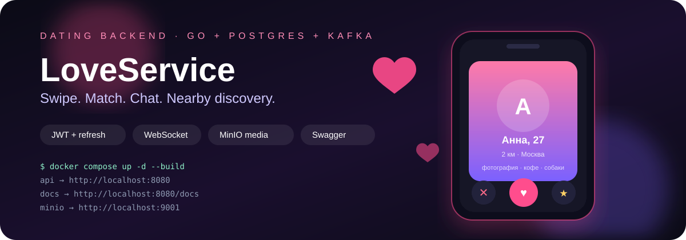
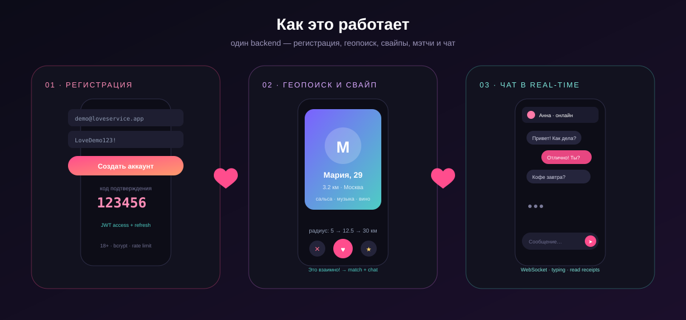
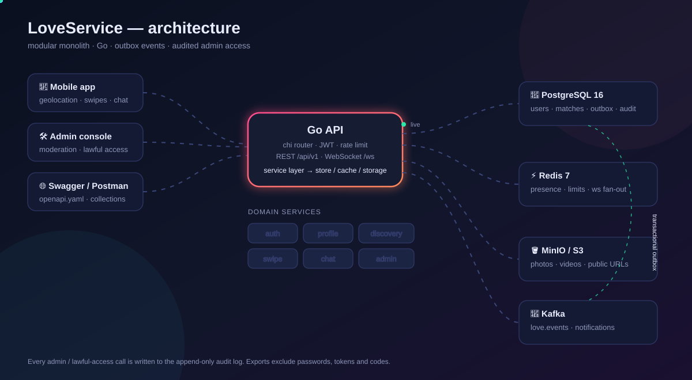

# LoveService — dating backend in Go



Production-shaped dating backend: registration, profiles, media uploads to
MinIO/S3, nearby discovery with an expanding radius, likes / dislikes /
superlikes, rewind, matches, real-time chat, notifications, blocks/reports,
moderation, and **audited lawful-access tooling for technical administrators**.

Version **1.2** adds monetization (“who liked me”, Premium, coins and virtual
gifts), ELO attractiveness ranking, device/session management, automatic face
verification, profile statistics and daily top picks.





## Quick start (Docker)

```bash
docker compose up -d --build
```

| Service | URL | Credentials |
|---|---|---|
| API | http://localhost:8080 | — |
| Swagger UI | http://localhost:8080/docs | Bearer token |
| OpenAPI YAML | http://localhost:8080/openapi.yaml | — |
| MinIO S3 | http://localhost:9000 | `minioadmin` / `minioadmin` |
| MinIO Console | http://localhost:9001 | `minioadmin` / `minioadmin` |
| Kafka UI | http://localhost:8081 | — |
| Postgres | `localhost:5432` | `love` / `love`, db `love` |
| Redis | `localhost:6379` | — |

Demo accounts (seeded automatically):

| Role | Email | Password |
|---|---|---|
| User | `demo@loveservice.app` | `LoveDemo123!` |
| Technical admin | `admin@loveservice.app` | `AdminDemo123!` |
| Moderator | `moderator@loveservice.app` | `ModeratorDemo123!` |

> Change `JWT_SECRET` and all demo passwords before exposing the service.

## What is implemented

- **Auth** — email/password registration, JWT access tokens (15 min), rotating
  opaque refresh tokens (30 days, hashed at rest), email verification codes,
  password reset, change password, logout.
- **Profiles** — bio, city, height, job, education, interests, looking-for,
  location, preferences (age/gender/radius/global mode), privacy settings.
- **Media** — multipart photo/video upload to MinIO (S3 API), 9 photos + 2 videos,
  primary photo, storage cleanup on delete.
- **Discovery** — haversine distance in SQL, age/gender filters, privacy-aware
  distance/online visibility, automatic radius expansion
  (5 → 12.5 → 30 → 75 → … km), ELO attractiveness ranking with
  `sort=balanced|distance|rating`, daily top picks.
- **Monetization** — “who liked me” hidden behind Premium or a 100-coin 24h
  unlock, mock subscription/top-up endpoints, coin wallet with transaction
  history, virtual gifts in chat (rose 10 · heart 25 · teddy 50 · ring 200 ·
  crown 500).
- **Swipes** — like/dislike/superlike, reciprocal-like match creation in one
  transaction, conversation creation, daily limits, rewind window (ELO changes
  are reversed on rewind).
- **Chat** — conversations, paginated messages, read receipts, typing events,
  photo/video messages, coin gifts, WebSocket push plus REST fallback.
- **Verification** — automatic face check: a selfie is compared with the primary
  profile photo by a pluggable ML provider (`FACE_VERIFY_*`), with a profile
  badge on approval and a full history of attempts.
- **Profile insights** — profile views (total and last 7 days), likes received,
  matches, and daily top picks.
- **Device management** — every login is a session with IP, platform, phone model
  and login date; list devices, log out one device or everywhere.
- **Notifications** — in-app notifications generated from domain events through a
  transactional outbox, Kafka fan-out (or in-process fallback), WebSocket push.
- **Safety** — blocks, reports, moderation queue.
- **Email** — the service generates verification/reset codes itself and delivers
  branded HTML + plain-text letters directly over SMTP (STARTTLS/TLS), with a
  development `.eml` outbox. See [docs/EMAIL.md](docs/EMAIL.md).
- **Admin** — stats, user search/detail, ban/deactivate, role management,
  verification badge, report triage, photo removal, broadcasts, retention purge,
  audit log.
- **Technical admin / lawful access** — legal-request workflow, optional second-
  admin approval, scoped data export, SHA-256 fingerprint, full audit trail.
- **Privacy** — any user can export their own data.
- **Observability** — health/readiness, Prometheus metrics, structured logs.

## Documentation

| Document | Contents |
|---|---|
| [docs/API.md](docs/API.md) | Endpoint reference and examples |
| [docs/FEATURES.md](docs/FEATURES.md) | Monetization, ELO ranking, verification, gifts and sessions |
| [docs/ARCHITECTURE.md](docs/ARCHITECTURE.md) | Components, data flow, design decisions |
| [docs/WEBSOCKET.md](docs/WEBSOCKET.md) | Real-time protocol and event catalogue |
| [docs/DEPLOYMENT.md](docs/DEPLOYMENT.md) | Docker, environment variables, mobile LAN setup |
| [docs/DEMO.md](docs/DEMO.md) | Animated walkthrough with demo credentials |
| [docs/TESTS.md](docs/TESTS.md) | Test layout, commands and coverage map |
| [docs/TEST_ACCOUNTS.md](docs/TEST_ACCOUNTS.md) | Seeded users and what to test |
| [docs/ADMIN_LAWFUL_ACCESS.md](docs/ADMIN_LAWFUL_ACCESS.md) | Lawful-access policy and workflow |
| [docs/EMAIL.md](docs/EMAIL.md) | Self-hosted email delivery: SMTP setup, HTML letters, preview |
| [docs/postman_collection.json](docs/postman_collection.json) | Postman collection (Import → Collection) |
| [docs/openapi.yaml](docs/openapi.yaml) | OpenAPI 3.1 specification |

## Device management (sessions)

Every successful login/registration creates a session row with the client IP,
platform, phone model and login date. Access tokens carry the session id, so a
revoked device is logged out on its next request rather than after the 15-minute
token TTL.

```bash
# Native clients send these headers on login/register:
#   X-Device-Platform: ios|android
#   X-Device-Model:    iPhone 15 Pro

curl -s http://localhost:8080/api/v1/sessions \
  -H "Authorization: Bearer $TOKEN"

curl -sX DELETE http://localhost:8080/api/v1/sessions/<session_id> \
  -H "Authorization: Bearer $TOKEN"

curl -sX POST http://localhost:8080/api/v1/auth/logout-all \
  -H "Authorization: Bearer $TOKEN"
```

`GET /api/v1/sessions` returns `id`, `platform`, `device_model`, `ip`,
`user_agent`, `created_at` (login date), `last_seen_at` and `current` (the device
making the request). `DELETE` logs out one device; `logout-all` revokes every
session and bumps `token_version`, invalidating all access tokens immediately.

## Local development without Docker

```bash
cp .env.example .env
go mod tidy
go run ./cmd/api
```

Requires Postgres, Redis, Kafka (optional) and MinIO. `KAFKA_ENABLED=false` and
`STORAGE_DRIVER=local` let you run without those services.

## Tests

Unit and black-box tests live in a separate `tests/` package tree that mirrors
`internal/`:

```text
tests/
├── docs/                       OpenAPI + Postman + compose validation
├── internal/
│   ├── app/                    composition root
│   ├── cache/                   Redis fallback, limits, presence
│   ├── config/                  env parsing and production guards
│   ├── domain/                  geo, models, errors
│   ├── events/                  outbox publisher, local bus
│   ├── mailer/
│   ├── observability/           logger + metrics middleware
│   ├── security/                JWT, bcrypt, validators
│   ├── service/                 pure service validation paths
│   ├── storage/                 local media storage
│   ├── store/                   DB integration (build tag)
│   ├── seed/                    demo seed (build tag)
│   └── transport/httpapi|ws/    router, Swagger, WebSocket handshake
└── integration/                 full HTTP + WebSocket flow (build tag)
```

```bash
go test ./...                         # fast unit suite, no infrastructure
go vet ./...
go test -tags=integration ./tests/integration/...   # needs the Docker stack
```

Smoke test against a running stack:

```bash
scripts/smoke.sh          # macOS / Linux / Git Bash
.\scripts\smoke.ps1       # Windows PowerShell
```

CI runs both suites: `.github/workflows/ci.yml`.

## Legal notice

The administrative endpoints exist to support **lawful** requests from competent
authorities. They must only be used with a verified legal basis, minimum
necessary scope, and in accordance with applicable data-protection law. Every
use is recorded in an append-only audit log.
